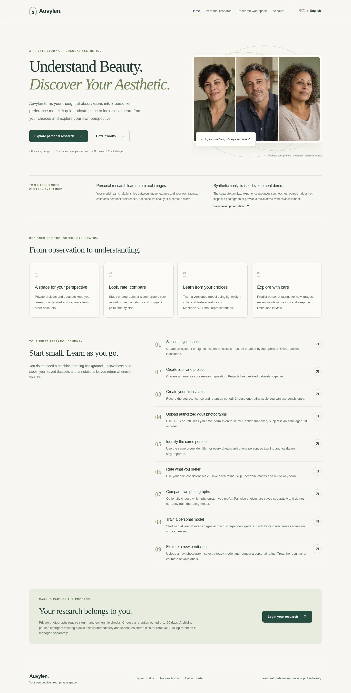

# Phase 5 — bilingual experience, design and resource use

Prepared in a disposable remote Linux workspace from `8598a54` on
`codex/phase4b-custom-preferences`. No live Codespace, Owner account, dataset,
private photograph, model checkpoint or backup was accessed or changed.

## Repository inspection and implementation

The inspected baseline already contained working accounts, Credits/redemption,
Owner authorization, private datasets/annotations, durable training jobs,
handcrafted and MobileNetV3-Small representations, versioned predictions,
Codespaces forwarding validation and encrypted backup tooling. No replacement
application or database schema was needed. The work preserves those services,
routes, identifiers and contracts.

Changes are concentrated in the Next.js presentation, shared upload metadata
contract, existing private upload endpoint and a small Owner overview optimization.
Implementation stages were: inspect the baseline and security regressions; add a
shared locale provider and visual shell; translate existing workflows and add
onboarding; improve upload transport and feedback; reduce redundant requests;
verify production behavior and document measurements. The main risks were losing
unsaved form state on language changes, confusing transport completion with saving,
and breaking the strict Codespaces ingress pattern. Tests explicitly cover these.

## Language and design

English source keys and the centralized `src/lib/i18n/zh-CN.json` dictionary provide
Simplified Chinese without duplicating pages. The server chooses the persisted
language cookie, then weighted Accept-Language, then English. The client starts
with that exact locale. Switching updates context, document language and the
one-year preference cookie without navigation or remounting forms. Server page
copy uses small switchable `Text` boundaries. Unknown future backend messages fall
back to their original English text; user names, dataset names and model identifiers
are never translated.

Coverage includes home/navigation, registration/login, account/Credits/redemption,
synthetic analysis/checkout/results/history, research authorization, projects and
datasets, upload/consent, ratings/comparisons, model settings/status/prediction,
Owner administration, errors, confirmations and accessibility labels. Dates use
the selected locale. Native form validation is localized. Automated checks cover
static translation keys and interpolation tokens, plus runtime language persistence
and switching with unsaved fields and an upload in flight.

The sage/ivory visual system supplies responsive navigation, clear focus styles,
consistent controls, cards, larger private-photo displays and reduced-motion
support. The home page explains the real personal preference workflow and separate
synthetic development demo, with nine linked beginner steps. Dataset checklists
and training readiness are derived from existing responses; no onboarding tables
or migrations were added. Models remain subjective preference estimators, and
MobileNet is described as a general image representation, not a validated facial
attractiveness model. Pairwise labels remain separately reviewable and are not
claimed to train the numerical model.

The only decorative photograph is an original generated image of fictional adults,
served locally as a 54,550-byte WebP. See [asset provenance](phase5/assets.md).
No external image/CDN/tracking requests were introduced.

## Upload behavior and compatibility

The queue retains File references and local object-URL previews, processes files
sequentially, blocks duplicate submissions, and reports confirmed file counts.
A retry skips confirmed files and preserves successful uploads. Identical-image
server deduplication makes retries after uncertain network outcomes safe.

States distinguish waiting/preparation, real browser-to-Next transport progress,
server processing and saving confirmed by a successful schema-validated response.
100% transport completion never means saved. Processing is intentionally
indeterminate: neither proxy forwarding nor database work has measurable browser
progress. The existing 15-second proxy upstream timeout remains; an ambiguous
failure explains safe retry. The browser transport has a 120-second timeout.

JPEG/PNG and 1 byte–4 MiB limits are checked before transmission. The UI also
explains existing server dimension/megapixel and private quota limits. Client-side
dimension decoding was deliberately avoided to keep large selected batches light;
the server remains authoritative for dimensions, format decoding and sanitization.
Batches are limited to 20 files and one active upload.

The same endpoint now accepts raw JPEG/PNG bytes with percent-encoded JSON consent
and group metadata in `X-Upload-Metadata`. Existing JSON/base64 clients still work.
Both forms use the same permission, ownership, retention, quota, concurrency,
image normalization, deduplication and storage logic. Metadata is validated before
binary-body ingestion. The proxy still bounds its request body; this is not a
streaming proxy rewrite.

## Measurements

Measurements use generated fixtures, never private portraits. They are local
comparisons, not live Codespaces latency or whole-process RSS guarantees.

| Measure | Before | Phase 5 |
|---|---:|---:|
| Body for a deterministic 1024×1024 PNG | 4,201,717 bytes JSON/base64 | 3,151,219 bytes binary (25% smaller) |
| Median peak traced Python allocations, parse + sanitize | 13,656,754 bytes | 6,303,081 bytes (54% lower) |
| Rating/comparison save API calls, excluding image delivery | 5 (CSRF, POST, 3 refresh GETs) | 2 (CSRF, POST) |
| Active personal-job polling interval | 1 second, overlapping possible | 3 seconds, sequential; hidden tabs make no requests |
| Owner extractor availability checks per extractor/request | 2 | 1 |
| All emitted JS chunks, raw | 1,048,687 bytes | 1,128,082 bytes |
| All emitted JS chunks, gzip level 9 | 292,167 bytes | 323,201 bytes |

The JS increase (~30 KiB gzip) buys bilingual resources and the new workflows;
this phase does not claim a smaller frontend bundle. Chunk totals are not an
individual route's download size. The optimized public portrait adds ~53 KiB.
Raw transport also removes FileReader/base64 strings in the browser and a redundant
proxy body copy. The benchmark's CPU/time samples and exact scope are in
[upload-benchmark.json](phase5/upload-benchmark.json); run
`uv run python scripts/benchmark-upload-transport.py` to reproduce. Tracemalloc
excludes native/Pillow memory, already-allocated request buffers and total RSS.
[Bundle measurement](phase5/bundle-measurement.json) compares production outputs
against the detached baseline using the same locked dependencies.

Private images and account responses retain no-store behavior. No shared/private
image cache was added. Thumbnail requests still deliver the existing sanitized
image; derivative storage would need a separate design and migration review.

## Verification and evidence

Local verification on 2026-10-19:

- Backend integration/regressions: **180 passed, 4 skipped**. The four opt-in
  pretrained checks require reviewed installed weights: custom training,
  Owner pretrained readiness, capacity, and extractor execution. Their skip is
  not reported as a successful MobileNet execution test. Existing MobileNet support
  and policy gates are preserved.
- Frontend unit tests: **129 passed**; ESLint and TypeScript checks pass.
- Python Ruff lint/format and strict mypy pass (66 source files).
- Production Next.js build passes. Alembic check reports no pending upgrade operations.
- Chromium: **6 passed** across bilingual navigation/forms, slow/partial uploads,
  rating/comparison edits, synthetic checkout, Credits redemption/history/login,
  real handcrafted training, prediction in Chinese and persistent retraining.
  Both bilingual tests passed again after the final icon/file-picker polish.
- Built Next.js → FastAPI Codespaces login tests pass within the backend suite;
  direct/forwarded Origin, CSRF, sessions, Owner and private-image regressions remain.

Browser screenshots contain only public generated artwork and mock research data;
no live photographs, credentials or account information appear:

[Chinese home, mobile](phase5/home-zh-mobile.webp) ·
[Chinese research, mobile](phase5/research-zh-mobile.webp)

The five existing CI jobs remain cloud-research, backend, frontend,
commercial-browser and deployment. The commercial browser job now also enables
real research training/prediction coverage with generated test fixtures.

## Security and safe rollout

No schema migration, dependency addition, authentication/authorization policy,
Owner entitlement, session cookie, CSRF or FastAPI Origin weakening is included.
The PR #3 `proxy-origin.ts` validation is unchanged. Tests exercise the rewritten
localhost Host/Origin plus validated Codespaces forwarding headers. Public asset
exceptions are exact paths; private-image exclusions remain. No raw private inputs,
credentials, passphrases or model weights are committed. Existing backup scripts,
retention/deletion behavior, workers and model versions are preserved.

Do not merge or deploy automatically. After reviewing the PR and all five CI jobs,
the user can update the **existing private Codespace**:

1. Follow the [established encrypted backup procedure](codespaces-private-preview.md#encrypted-backup).
   Verify the encrypted backup and retain a copy outside the Codespace before rollout.
2. Ensure the working tree is clean; inspect the reviewed merge on
   `codex/phase4b-custom-preferences`. Do not overwrite local work.
3. Stop application processes with `python scripts/codespaces-preview.py stop`.
   Pull only the reviewed target branch with `git pull --ff-only`. No dependency
   changes or migrations are required for this phase. Run `npm run build` using
   the existing locked installation. If it fails, keep the app stopped and investigate.
4. Run `python scripts/codespaces-preview.py start` and `status`. Confirm port 3000
   remains Private and API/database ports remain private/internal. Do not recreate
   the Codespace, regenerate env secrets, run Owner initialization or remove volumes.
5. Open the existing HTTPS URL and sign in normally. Check the Owner dashboard,
   account/Credits, language switching and the existing ORIGIN/ORIGIN_01 counts.
   Do not upload, train on, modify or delete live research data merely to smoke-test
   rollout without the user's permission. Check an already authorized private image
   only within the user's own browser. Keep the verified external backup intact.

The actual live Codespaces ingress and its CPU/memory performance require a
post-approval smoke check by the user. Implementation verification uses isolated
test services and simulated forwarding, not the live site.
